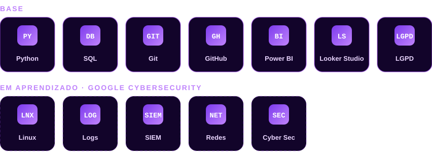

 

 

 

> 🔐 *Proteger dados é tão importante quanto analisá-los. Meu caminho profissional é a segurança da informação.*

Sou estudante de **Ciência de Dados para Negócios** e meu objetivo profissional é atuar com **Data Security e Cyber Security**. Minha formação em dados é a base: entendo como a informação é coletada, armazenada e usada, e quero aplicar isso para **protegê-la**, de incidentes, vazamentos e uso indevido.

<table>
<tr>
<td width="50%" valign="top">

### 🔒 Meu foco
- **Data Security** e proteção de informações
- **Cyber Security**
- **LGPD** e governança de privacidade
- **Análise de logs** e detecção de incidentes

</td>
<td width="50%" valign="top">

### 🧱 Minha base
- **Python** para automação e análise
- **SQL** para consulta e investigação de dados
- Dashboards em **Power BI** e **Looker Studio**

</td>
</tr>
</table>

 

 

 

 

| | |
|---|---|
| 🔒 **Google Cybersecurity Certificate** | *em andamento* |
| 🛡️ **LGPD** | Enap · *concluído, com certificado* |
| 🎓 **Ciência de Dados para Negócios** | FAE Centro Universitário · *em andamento* |
| ☁️ **Salesforce** | Fundamentos de CRM · *concluído* |
| 🤖 **Claude 101** | Anthropic · *concluído* |

### 🌍 Além do código

- 🇩🇰 Um ano de imersão cultural em **Copenhague**
- 🗣️ **Inglês avançado** · Espanhol e dinamarquês básicos
- 🤝 Liderança e gestão de projetos no **Rotary** (Interact e Intercâmbio de Jovens)

 

💬 **Vamos trocar uma ideia sobre segurança de dados, cyber security ou LGPD?**

